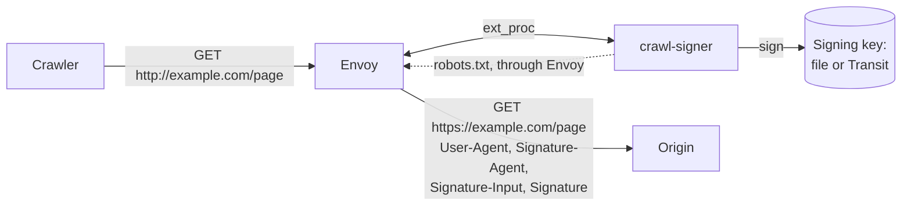

# crawl-signer

An [Envoy](https://www.envoyproxy.io) external processor that turns Envoy into a crawl gateway. Your crawlers send
plain HTTP requests through it. Each request that leaves has been checked against fixed rules and the origin's
robots.txt, and carries the crawler's identity: a `User-Agent`, and a
[Web Bot Auth](https://datatracker.ietf.org/wg/webbotauth/about/) signature
([RFC 9421](https://www.rfc-editor.org/rfc/rfc9421)) that Cloudflare and other sites verify to recognise your bot.

The crawlers never hold the signing key, and they can't change what they send as. One gateway gives every
crawler the same identity, from addresses only the gateway uses.



## What it enforces

For every request, in this order:

- **Rules.** `GET` or `HEAD`, no body, the scheme's default port, and a hostname or public address as the target.
  Literal internal addresses are refused in every spelling, including IPv4 embedded in IPv6.
- **robots.txt.** The origin's rules for your product token, per [RFC 9309](https://www.rfc-editor.org/rfc/rfc9309)
  and Google's parser. If robots.txt can't be fetched and no copy is cached, the request is refused.
- **Identity.** crawl-signer sets `User-Agent`, `From`, `Signature-Agent`, `Signature-Input` and `Signature`. It
  removes every other header except six content-negotiation and caching headers, including cookies and
  credentials.

A request crawl-signer can't decide on is refused, never sent unchecked. Each refusal says why in an
`X-Crawl-Gateway-Refusal` header, and every verdict reaches Envoy's access log and a Prometheus counter.

## Quick start

With Envoy on the host and `examples/envoy.yaml` as its configuration, generate a key and start crawl-signer:

```bash
openssl genpkey -algorithm ed25519 -out /etc/crawl-signer/key.pem
crawl-signer -config /etc/crawl-signer/config.json
```

```json
{
  "listen": "/run/crawl-signer/grpc.sock",
  "envoy_socket": "/run/envoy/internal.sock",
  "user_agent": "Mozilla/5.0 (compatible; ExampleBot/1.0; +https://bot.example.com)",
  "signature_agent": "https://bot.example.com",
  "robots_agent": "ExampleBot",
  "robots_cache_bytes": 67108864,
  "signing_key": { "private_key": { "filename": "/etc/crawl-signer/key.pem" } }
}
```

Then send a request through it, as through any HTTP proxy:

```bash
curl --proxy http://127.0.0.1:3128 http://example.com/
```

[Getting started](docs/getting-started.md) covers the whole setup, from download to a verified signature.

## Before you deploy it

Envoy's configuration is part of the security model: crawl-signer can only refuse what Envoy asks it about. Start
from [`examples/envoy.yaml`](examples/envoy.yaml), and read [Deploy with Envoy](docs/guides/deploy-with-envoy.md)
and the [security model](SECURITY.md#security-model) before callers on other hosts use the gateway.

crawl-signer doesn't limit request rates and doesn't apply `Crawl-delay`; that's for your crawlers' scheduler.
[Limitations](docs/explanation/limitations.md) lists the rest.

## Documentation

- [Getting started](docs/getting-started.md)
- Guides: [deploy with Envoy](docs/guides/deploy-with-envoy.md),
  [choose a signing key](docs/guides/choose-a-signing-key.md),
  [become a verified bot](docs/guides/become-a-verified-bot.md),
  [verify a release](docs/guides/verify-a-release.md), [troubleshoot](docs/guides/troubleshoot.md)
- Reference: [configuration](docs/reference/config.md), [Envoy interface](docs/reference/envoy-interface.md),
  [metrics](docs/reference/metrics.md)
- Explanation: [how a request flows](docs/explanation/how-a-request-flows.md),
  [robots.txt](docs/explanation/robots-txt.md), [signatures](docs/explanation/signatures.md),
  [limitations](docs/explanation/limitations.md)
- [Testing](docs/testing.md), [contributing](CONTRIBUTING.md), [security policy](SECURITY.md)

## License

[Mozilla Public License 2.0](LICENSE)
