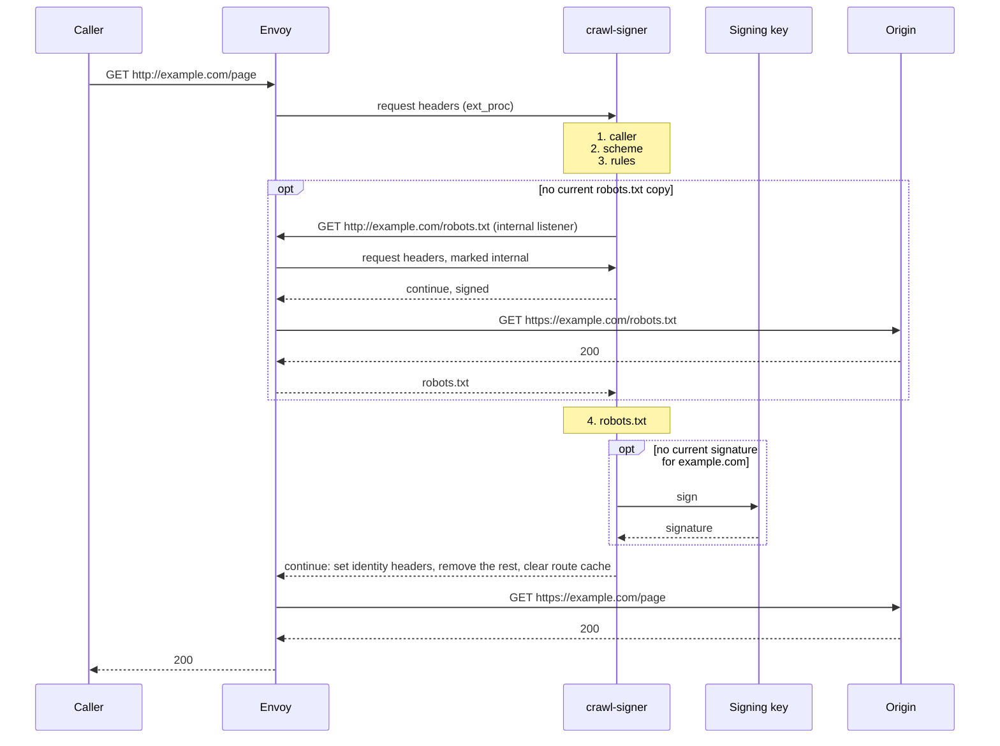

# How a request flows

A crawler sends `GET http://example.com/page` to the gateway as to an HTTP proxy. The request reaches the origin as
`GET https://example.com/page` with your bot's identity, or the crawler gets a refusal that says why. Here's what
happens in between.

1. **Caller.** crawl-signer notes who is asking: `internal` for a request on Envoy's
   [internal listener](../reference/envoy-interface.md#the-internal-listener), the Tailscale node with
   [`tailscale_whois`](../reference/config.md#tailscale_whois), otherwise `unknown`. This is only recorded, never
   decides anything.
2. **Scheme.** https, unless the caller sends `X-Crawl-Scheme: http`. Callers send `http://` URLs either way: an
   `https://` URL would make the client open a `CONNECT` tunnel, which hides the request from the gateway and is
   refused.
3. **Rules.** The method, body, port and target, as the
   [security model](../../SECURITY.md#g2-only-a-get-or-head-without-a-body-to-a-hostname-or-a-public-address-on-the-schemes-default-port)
   lists them. They need nothing outside the request, so they run first and refuse cheaply.
4. **robots.txt.** From the cache, or fetched through Envoy: see [robots.txt](robots-txt.md). crawl-signer's own
   fetches skip this step; the rest apply to them.
5. **Signature.** From the cache, or from the signing key: see [Signatures](signatures.md).
6. **Headers.** crawl-signer tells Envoy which headers to set and which to remove, and to choose the route again.
   Envoy routes plain-http requests by the `X-Crawl-Upstream` header crawl-signer sets, then removes it with the
   headers Envoy added itself.

Envoy's dynamic forward proxy then resolves the name, opens the connection (TLS, with the origin's certificate
checked, for https) and sends the request. The answer goes back to the caller unchanged.

Any step that refuses ends the request with an immediate answer from Envoy; the origin sees nothing. Every outcome is
recorded in Envoy's [dynamic metadata](../reference/envoy-interface.md#dynamic-metadata) for the access log, and
counted in [`crawl_signer_requests_total`](../reference/metrics.md).

## Why an external processor

Envoy already does the hard parts of a forward proxy: DNS, connection pooling, TLS to arbitrary origins, timeouts,
limits. crawl-signer adds only the decision and the identity, and holds no connection to an origin. A bug in it
can refuse requests, but it can't corrupt a response, and Envoy refuses everything when crawl-signer is down.

The price is one gRPC round trip over a Unix socket per request, and Envoy's configuration becoming part of the
security model: [Deploy with Envoy](../guides/deploy-with-envoy.md) says which parts.
